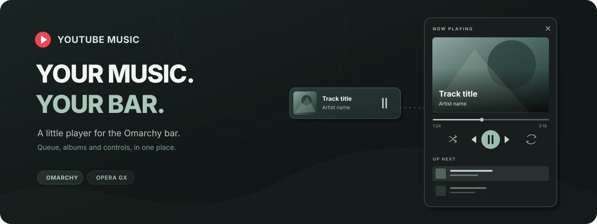

<p align="center">
  
</p>

<h1 align="center">YouTube Music для Omarchy</h1>

<p align="center">
  Музыка всегда под рукой: компактный плеер в панели Omarchy,<br>
  синхронизированный с YouTube Music в Opera GX.
</p>

<p align="center">
  
  
  <a href="LICENSE"></a>
</p>

<p align="center">
  <a href="#установка">Установка</a> ·
  <a href="#управление">Управление</a> ·
  <a href="#обновление">Обновление</a> ·
  <a href="#если-плеер-не-видит-музыку">Помощь</a>
</p>

> Баннер — иллюстрация интерфейса. Цвета плеера подстраиваются под тему Omarchy.

## Возможности

- **Плеер в панели** — обложка и название трека, кнопки воспроизведения и переключения.
- **Карточка при наведении** — информация о треке и перемотка; по нажатию открывается полный плеер.
- **Очередь и альбомы** — выбор трека из списка, подсветка текущего и сохранение положения прокрутки при смене песни.
- **Перемешивание и повтор** — управление режимами с анимацией и откликом на нажатие.
- **Плавные переходы** — обложка меняется свайпом, текст и кнопки анимируются.
- **Несколько источников** — можно выбрать нужную открытую сессию YouTube Music.

## Установка

Понадобятся **Omarchy с Quickshell**, **Opera GX** и Python с `aiohttp`. Плагин проверен на Omarchy 4.0.6; установщик при необходимости установит `python-aiohttp` через Omarchy.

**1. Установи плагин и фоновый сервис:**

```bash
curl -fsSL https://raw.githubusercontent.com/6axam/omarchy-youtube-music/main/install.sh | bash
```

**2. Создай отдельный запускатель Opera GX:**

```bash
bash ~/.config/omarchy/plugins/6axam.youtube-music/setup-browser.sh
```

**3. Закрой Opera GX и открой её командой, которую выведет скрипт.** Затем открой YouTube Music в боковой панели или вкладке и включи трек. Для связи с плеером браузер нужно запускать через созданный запускатель.

Если скрипт не находит Opera GX, укажи абсолютный путь к её исполняемому файлу или запускателю:

```bash
OPERA_GX_COMMAND=/путь/к/opera-gx bash ~/.config/omarchy/plugins/6axam.youtube-music/setup-browser.sh
```

## Управление

| Действие | Результат |
| --- | --- |
| Навести на плеер в панели | Показать карточку трека с перемоткой |
| Нажать обложку или кнопку открытия | Развернуть полный плеер и очередь |
| Нажать трек в очереди | Переключиться на него в YouTube Music |
| Нажать крестик в полном плеере | Свернуть его в карточку |
| Увести курсор с виджета | Закрыть карточку |

Если открыто несколько сессий YouTube Music, нужную можно выбрать внизу полного плеера. Выбор запоминается.

## Доступ к браузеру

Созданный запускатель включает Chrome DevTools на `127.0.0.1:9222`. Любая локальная программа, способная подключиться к этому порту, может управлять браузером и получать доступ к данным его вкладок. Используй запускатель только в доверенной среде.

Плагин работает с открытой страницей `music.youtube.com`, не запрашивает пароль и не отправляет данные на собственный сервер. Обычный запускатель и профиль браузера скрипт не меняет.

## Обновление

```bash
omarchy plugin update 6axam.youtube-music
systemctl --user restart omarchy-youtube-music.service
omarchy restart shell
```

## Если плеер не видит музыку

1. Убедись, что Opera GX запущена через созданный запускатель и в ней открыта страница YouTube Music.
2. Проверь сервис: `systemctl --user status omarchy-youtube-music.service`.
3. Если открыто несколько сессий, выбери нужную внизу полного плеера.

Если проблема осталась, её можно описать в [Issues](https://github.com/6axam/omarchy-youtube-music/issues).

## Удаление

```bash
bash ~/.config/omarchy/plugins/6axam.youtube-music/uninstall.sh
omarchy plugin remove 6axam.youtube-music
```

Профиль браузера не удаляется; кэш музыкальных данных сохраняется.

---

Создано для Omarchy · [Лицензия MIT](LICENSE)
